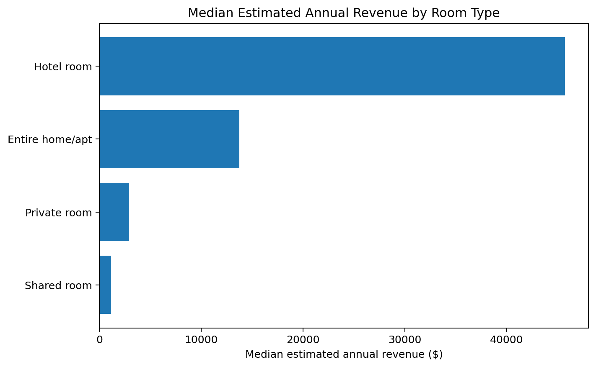
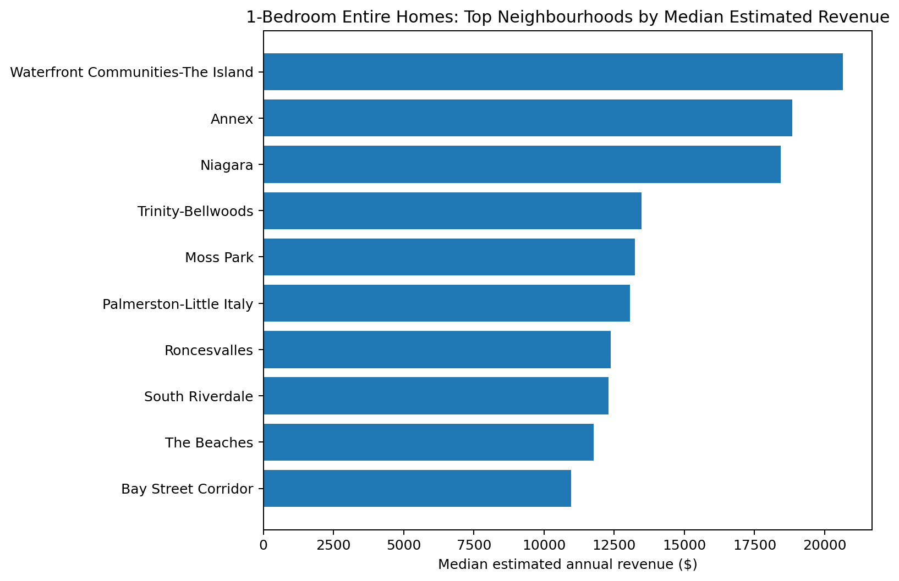
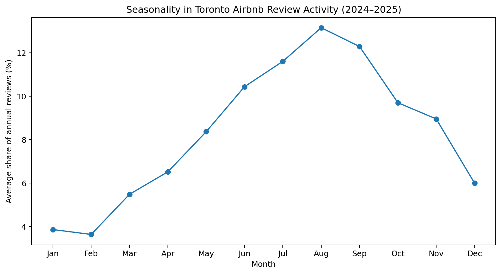
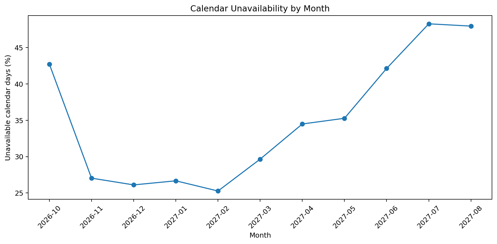
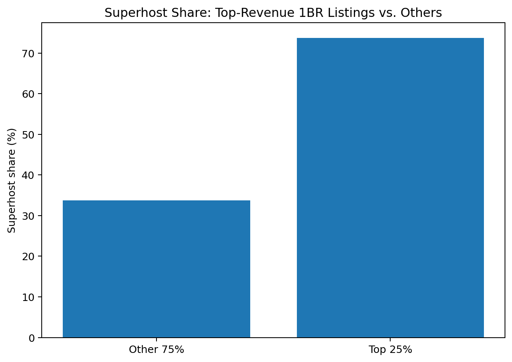

# Toronto Airbnb Market & Performance Benchmarking

An end-to-end Python/Pandas analysis of Toronto's short-term rental market using
**22,050 listings**, **729,202 reviews**, and **8.0M calendar records** from
[Inside Airbnb](https://insideairbnb.com/get-the-data/).

The goal is not just to describe the market, but to answer a host-style business question:

> **How do comparable Toronto Airbnb listings perform, and what characteristics are associated with stronger estimated performance?**

## Executive summary

After cleaning price and revenue fields, **16,760 listings** were used for the main
performance analysis.

### Key findings

1. **Entire homes materially outperform private rooms on the modeled revenue metric.**  
   Median estimated annual revenue is approximately **$13,744** for entire
   homes/apartments versus **$2,908** for private rooms.

2. **Location matters even after narrowing the comparison to one-bedroom entire homes.**  
   Among neighbourhoods with at least 50 comparable listings, the highest median
   estimated annual revenue was:
   - **Waterfront Communities-The Island — $20,654**
     (1,392 listings)
   - **Annex — $18,843**
     (275 listings)
   - **Niagara — $18,432**
     (331 listings)

3. **Top-revenue one-bedroom listings look operationally different from the rest.**  
   The top quartile has median modeled revenue of **$46,478**
   versus **$5,951** for the other 75%.
   Top-quartile listings also have:
   - median estimated occupancy of **180 nights**
     vs. **48**
   - median **24 recent reviews** vs.
     **1**
   - **73.7%** Superhost share vs.
     **33.8%**
   - median minimum stay of **1 night(s)** vs.
     **28**

4. **Review activity is strongly seasonal.**  
   Using complete 2024–2025 years, August accounts for about
   **13.2%** of annual review activity on average, followed by
   September (**12.3%**) and July
   (**11.6%**). January and February are the quietest months.

5. **Future calendar unavailability rises into summer, but this is not the same as booked occupancy.**  
   Across full months in the forward calendar, the unavailability rate is about
   **25.3%**
   in February 2027 versus
   **48.3%**
   in July 2027. Airbnb calendars do not distinguish booked nights from host-blocked dates.

## Business implications

For a Toronto host or marketplace analyst, the results suggest four practical ways to use
the data:

- **Benchmark like-for-like.** A city-wide average is not very useful for an individual
  listing. Room type, bedroom count, and neighbourhood materially change the benchmark.
- **Plan around seasonality.** Review activity peaks in the summer/early fall in the two
  complete recent years analyzed, so pricing and calendar strategy should be reviewed
  before the July–September period rather than after it.
- **Investigate operational differences, not just price.** Top-quartile one-bedroom
  listings are much more likely to be Superhosts, receive more recent reviews, and have
  shorter minimum-stay requirements. These are associations, not proof of causation, but
  they provide useful hypotheses for further testing.
- **Use modeled revenue directionally.** The estimated revenue field is useful for
  relative benchmarking, but it should not be treated as verified host income.

## Visual analysis

### Revenue differs substantially by room type



### Comparable one-bedroom listings still vary by neighbourhood

To avoid comparing fundamentally different properties, this benchmark uses only
**one-bedroom entire homes/apartments** and requires at least **50 listings per neighbourhood**.



### Guest activity shows a clear seasonal pattern

Review counts are treated as a proxy for activity rather than a direct booking count.
The chart averages each month's share of annual reviews across the complete 2024 and 2025 years.



### Future calendar unavailability also rises toward summer

Unavailable dates may be either booked or manually blocked, so this metric is deliberately
labeled **calendar unavailability**.



### High-revenue listings are much more likely to be hosted by Superhosts



## Method

1. Loaded the detailed Toronto listings, calendar, and review files.
2. Converted listing prices from currency strings to numeric values.
3. Removed records missing the two fields needed for revenue benchmarking:
   price and estimated annual revenue.
4. Retained unusual high-price listings rather than silently deleting them; medians and
   minimum sample-size rules are used to reduce sensitivity to extreme values.
5. Aggregated the 8M-row calendar file in chunks to avoid unnecessary memory use.
6. Compared like-for-like one-bedroom entire homes across neighbourhoods.
7. Used detailed review dates to estimate seasonal patterns.
8. Compared the top revenue quartile with the remaining one-bedroom listings.

## Important limitations

This project intentionally treats the Inside Airbnb revenue/occupancy fields as **modeled
estimates**, not verified host financials. Inside Airbnb describes its occupancy model as
review-based and states that Airbnb's public calendar cannot distinguish a booked date from
a host-blocked date.

That means:

- estimated revenue should be interpreted as a benchmarking signal, not audited income;
- price and estimated occupancy are mechanically related to estimated revenue, so the
  top-quartile comparison is descriptive, not causal;
- calendar unavailability is **not** labeled occupancy;
- review activity is a useful seasonality proxy, but not every guest leaves a review;
- the dataset is a September 2026 market snapshot and does not capture every listing over time.

## Repository structure

```text
toronto-airbnb-performance-analysis/
├── README.md
├── requirements.txt
├── .gitignore
├── data/
│   └── README.md
├── notebooks/
│   └── toronto_airbnb_analysis.ipynb
├── src/
│   └── analyze_airbnb.py
├── outputs/
│   ├── room_type_summary.csv
│   ├── one_bed_neighbourhood_benchmark.csv
│   ├── top_quartile_comparison.csv
│   ├── monthly_review_counts.csv
│   ├── review_seasonality_2024_2025.csv
│   └── calendar_unavailability_by_month.csv
└── images/
    ├── median_revenue_by_room_type.png
    ├── one_bed_neighbourhood_benchmark.png
    ├── review_seasonality.png
    ├── calendar_unavailability.png
    └── superhost_share.png
```

## Reproduce the project

1. Download the Toronto **16 September 2026** detailed files from
   [Inside Airbnb](https://insideairbnb.com/get-the-data/).
2. Put `listings.csv.gz`, `calendar.csv.gz`, and `reviews.csv.gz` in `data/`.
3. Install dependencies:

```bash
pip install -r requirements.txt
```

4. Run:

```bash
python src/analyze_airbnb.py
```

Or open `notebooks/toronto_airbnb_analysis.ipynb`.

## Tools

Python · Pandas · NumPy · Matplotlib · Jupyter

## Data source

Inside Airbnb — Toronto, Ontario, Canada, 16 September 2026.  
Data source: https://insideairbnb.com/get-the-data/  
Methodology / assumptions: https://insideairbnb.com/data-assumptions/
